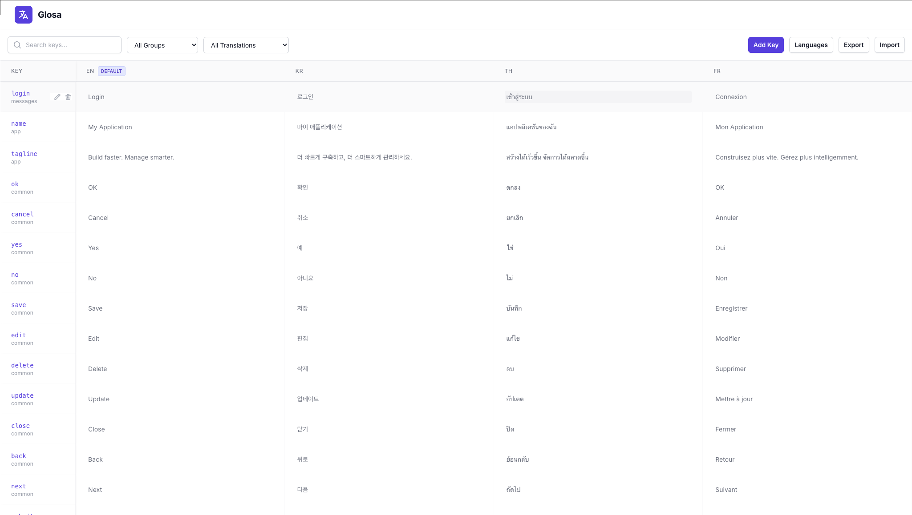

# Glosa

[](https://packagist.org/packages/php-junior/glosa)
[](https://packagist.org/packages/php-junior/glosa)


A standalone Laravel Translation Management System package. Managed your translations with a beautiful UI.



## Installation

You can install the package via composer:

```bash
composer require php-junior/glosa
```

## Configuration

Publish the config file with:

```bash
php artisan vendor:publish --tag="glosa-config"
php artisan migrate
```

This will create a `config/glosa.php` file in your app, where you can configure the route prefix, middleware, and API settings.

### Route Prefix

By default, the UI is accessible at `/glosa`. You can change this in the config:

```php
'route_prefix' => 'translations',
```

### Authorization

Glosa exposes a dashboard at `/glosa`. By default, this is only accessible in the `local` environment. To allow access in other environments, you must define the `viewGlosa` gate in your `AppServiceProvider` (or `AuthServiceProvider`).

```php
use Illuminate\Support\Facades\Gate;

public function boot()
{
    Gate::define('viewGlosa', function ($user) {
        return in_array($user->email, ['admin@app.com']);
    });
}
```

## Features

### Public API

Glosa provides a public API endpoint to fetch translations for a specific locale. This is useful for Single Page Applications (SPAs) or mobile apps.

**Endpoint:** `GET /api/translations/{locale}`

**Configuration:**

You can enable/disable this feature and control the response format in `config/glosa.php` or your `.env` file:

```dotenv
GLOSA_ENABLE_PUBLIC_API=true
GLOSA_PUBLIC_API_URL=api/translations/{locale}
GLOSA_PUBLIC_API_NESTED=true
```

-   `GLOSA_ENABLE_PUBLIC_API`: Set to `true` to enable the endpoint.
-   `GLOSA_PUBLIC_API_URL`: Customize the endpoint URL. Must include `{locale}`.
-   `GLOSA_PUBLIC_API_NESTED`:
    -   `true` (default): Returns nested JSON (e.g., `{"messages": {"welcome": "Hello"}}`)
    -   `false`: Returns dot-notation JSON (e.g., `{"messages.welcome": "Hello"}`)

### Export Feature

You can export translations for a specific locale as a JSON file via the UI or the export endpoint.

**Endpoint:** `GET /glosa/export?locale={locale}&nested={boolean}`

-   `locale`: The locale code (e.g., `en`).
-   `nested`: `1` for nested JSON, `0` for dot notation.

### Import From Lang Directory

Import your existing Laravel translation files into the database:

```bash
# Import the application's lang directory
php artisan glosa:import

# Import a custom directory (absolute or relative to the project root)
php artisan glosa:import resources/lang

# Import every module's lang directory (quote the pattern, or let the shell expand it)
php artisan glosa:import "app/Modules/*/lang"
php artisan glosa:import "src/Domain/*/Resources/lang" lang

# Only import specific locales
php artisan glosa:import --locale=en --locale=fr

# Overwrite values that already exist in the database
php artisan glosa:import --overwrite
```

-   `{locale}/{group}.php` files are imported with the file name as the group, and nested arrays as dot-notation keys (e.g. `auth.custom.email.required`). Files in subdirectories keep their path as the group (e.g. `admin/users`).
-   `{locale}.json` files are imported as JSON translations, with keys kept as-is.
-   Missing locales are created automatically. If no default locale exists, the one matching `app.locale` becomes the default.
-   Namespaced translations are supported (see [Namespaced Translations](#namespaced-translations)). If a directory is registered with `loadTranslationsFrom($path, 'client')`, its keys are stored under the `client` namespace. Use `--namespace=client` to set it explicitly.
-   Package overrides in `lang/vendor/{namespace}/{locale}/{group}.php` are imported under their namespace.
-   Existing values are kept unless `--overwrite` is given.

### Laravel Translation Loader

Glosa integrates seamlessly with Laravel's native translation system. You can use `__('key')` or `trans('key')` to fetch translations directly from the database.

**How it works:**
The package replaces the default translation loader. It loads your language files as usual, then merges the database translations on top, so database values override file values. If a key has no value for the requested locale, the value of the default locale is used.

**Configuration:**

By default, this feature is enabled. You can disable it in `config/glosa.php` or `.env`:

```dotenv
GLOSA_ENABLE_DB_LOADING=true
```

### Namespaced Translations

Translations registered by packages or modules with `loadTranslationsFrom($path, 'client')` are used as `__('client::labels.app_url')`. Glosa stores these keys with their namespace, and the translation loader reads them from the database just like global keys.

-   **UI**: Enter the group with a namespace prefix, e.g. Group `client::labels` and Key `app_url`. A group without a prefix (e.g. `labels`) is a global group.
-   **Import command**: The namespace is detected automatically from `loadTranslationsFrom()` registrations, or set with `--namespace`.
-   **Export, public API and JSON import**: Namespaced keys use the `client::labels.app_url` format, so an exported file can be imported again.

### Usage

1.  Navigate to `/glosa` (or your configured prefix).
2.  **Add Locales**: Create the languages you want to support (e.g., `en`, `fr`, `es`).
3.  **Add Keys**: Create translation keys with a group and a key (e.g. group `auth`, key `failed` for `__('auth.failed')`). Use a `namespace::group` group for namespaced translations (e.g. `client::labels`).
4.  **Translate**: Enter values for each key and locale directly in the grid.
5.  **Import**: Upload existing JSON translation files, or import a lang directory with `php artisan glosa:import`.

## Upgrading

When upgrading to a version with namespace support:

```bash
php artisan migrate
```

If you published the views (`glosa-views`), publish them again so namespaced keys keep their namespace when edited:

```bash
php artisan vendor:publish --tag="glosa-views" --force
```

## License

The MIT License (MIT).
